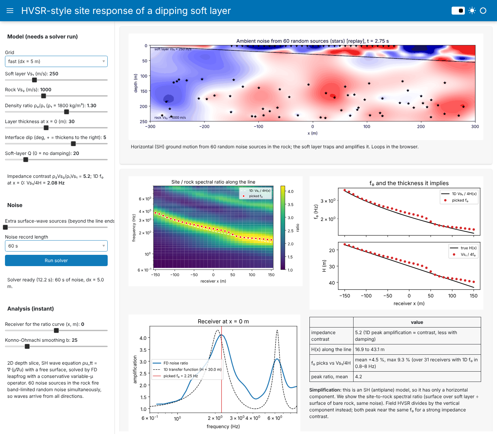

# HVSR-style site response of a dipping soft layer from ambient noise

A 2D depth slice (x–z) with a soft layer over rock. The user sets the interface **dip** and the **property contrast** (Vs and density, so the impedance contrast). 60 random noise sources in the rock fire band-limited noise at the same time, so waves reach the surface from all directions. The SH wave equation

$$\rho\,u_{tt} + \rho\,\sigma\,u_t = \partial_x(\mu\,\partial_x u) + \partial_z(\mu\,\partial_z u) + \rho f,\qquad \mu = \rho V_s^2,\qquad \mu\,\partial_z u = 0 \text{ at } z = 0$$

is solved by finite differences (2nd-order leapfrog in time, conservative 2nd-order operator with harmonic μ on cell faces, mirror free surface, damping sponges, viscous damping with Q = 20 in the layer). 31 receivers along the surface record the horizontal motion. Each receiver's spectrum is divided by the spectrum of bare rock under the same noise, and f₀ is picked from that ratio and compared with the 1D rule f₀ = Vs₁/4H(x).

**Simplification.** A scalar/SH model has only a horizontal (out-of-plane) component, so it cannot form a true H/V ratio. We use the site-to-reference spectral ratio instead. For a strong contrast it peaks near the same f₀ as field HVSR, but the amplitudes are not those of H/V.



| file | contents |
|---|---|
| `hvsr.py` | All numerics: `Model` (two layers, dip, contrast, damping, 1D f₀ and the analytic transfer function), `noise_sources`, `simulate_noise` (the solver), Welch spectra, Konno–Ohmachi smoothing, `spectral_ratio`, `pick_f0`, `run_profile`. No UI code. |
| `hvsr_app.py` | Panel UI: `panel serve hvsr_app.py --show`. Sliders for Vs₁, Vs₂, the density ratio, thickness, dip, Q, surface-wave sources and record length. It shows a live then looping wavefield animation, the ratio along the line, and f₀ and the implied thickness vs the truth. After the run, a station slider picks which station's H/V curve to show next to the true 1D amplification, with a tile of site-amplification predictions from that curve: f₀, peak amplification, depth to rock, the building heights at risk of resonance (about 0.1 s of natural period per storey) and Vs30, each against the true value. A run takes about 12 s on the fast grid and is cached. |
| `hvsr_verification.ipynb` | FD vs the analytic 1D SH transfer function (f₀ 2.087 vs 2.084 Hz, peak 5.17 vs 5.11, 1.5% L2 error). Convergence order 1.8 in Δx and 1.7 in Δt. Sponge length: 150 m gives 32% error at 1–4 Hz, 400 m gives 5%, 1000 m gives 1%. The sub-cell interface keeps f₀ within 1.6% between grid nodes. Flat layer under noise from all directions: f₀ within 3.6%. |
| `hvsr_dipping_layer.ipynb` | **Main results** (below). About 10 min to run. |

## Main findings
- **Flat layer.** With noise from all directions, f₀ = Vs₁/4H within 4% at every receiver. The peak is about 12% below the 1D vertical-incidence value.
- **Dip.** f₀ varies more smoothly along the line than Vs₁/4H(x), so converting with the 1D rule underestimates the depth. The mean error is −4% at 5°, −11% at 10° and −15% at 15°, and up to −25 to −35% under the thick side.
- **Contrast.** A stronger contrast makes the 2D error larger, not smaller. At 10° dip the f₀ error is about 5% for a contrast of 2.6 but 20–35% for a contrast of 10, because a strong contrast traps the waves and lets them spread along the layer. The peak is taller and easier to pick, but harder to interpret with 1D theory.
- **Surface-wave noise** from nearby lateral sources makes the ratio station-dependent.

## Running it yourself

```bash
git clone https://github.com/zach-shallenberger/GPCOMP-ambient-directionality.git
cd GPCOMP-ambient-directionality
conda env create -f environment.yml     # isolated env named "ambient-noise"
conda activate ambient-noise
```

No conda? Use a virtual environment instead: `python -m venv .venv`, activate it (`source .venv/bin/activate`, or `.venv\Scripts\activate` on Windows), then `pip install -r requirements.txt`.

**App.** `panel serve hvsr_app.py --show`. On load it runs the default model and its bare-rock reference (about 12 s on the fast grid). The wavefield is drawn live while it runs, then loops as an animated GIF. Change the model sliders and press *Run solver*. The station slider and the smoothing control update instantly. Every model is saved to `.cache/`, so it reloads instantly later.

**Notebooks.** Run `jupyter notebook`, open a notebook and choose *Run All*: `hvsr_verification` takes about 2 min, `hvsr_dipping_layer` about 10 min.

**From your own script.**

```python
import hvsr as H

m = H.Model(vs1=250, vs2=1000, h0=30, dip=10)     # soft layer over rock, 10 deg dip
r = H.run_profile(m, H.default_grid(5.0), T=60)   # site run + bare-rock reference (~15 s)
for x, f0 in zip(r["rec_x"], r["f0"]):
    print(f"x = {x:5.0f} m   f0 = {f0:.2f} Hz   1D Vs1/4H = {m.f0_1d(x):.2f} Hz")
```

Units are SI (m, s, m/s, kg/m³).

## AI-use statement
This project was developed with Claude (Anthropic) used as an AI coding agent through Claude Code. Claude helped draft the project plan and the solver, spectral-ratio and picking code, the UI code and the notebooks, and ran the verification tests. I checked the physics and results and am responsible for them. *(Edit this statement to describe how you actually reviewed and changed the code.)*

## References
- Nakamura, Y. (1989). A method for dynamic characteristics estimation of subsurface using microtremor on the ground surface. *QR of RTRI* 30(1), 25–33.
- Konno, K., & Ohmachi, T. (1998). Ground-motion characteristics estimated from spectral ratio between horizontal and vertical components of microtremor. *BSSA* 88(1), 228–241.
- Bard, P.-Y., & Bouchon, M. (1985). The two-dimensional resonance of sediment-filled valleys. *BSSA* 75(2), 519–541.
- SESAME (2004). Guidelines for the implementation of the H/V spectral ratio technique on ambient vibrations. European Commission project WP12.
- Kramer, S. L. (1996). *Geotechnical Earthquake Engineering*. Prentice Hall (1D SH transfer function of a layer over a half-space).
- Virieux, J. (1984). SH-wave propagation in heterogeneous media: velocity-stress finite-difference method. *Geophysics* 49(11), 1933–1942.
- Course notebooks GPGN 436/536 (Dr. Ge Jin, Dr. Jeff Shragge), especially 06_Hyperbolic_PDEs (FD wave solver).
- Libraries: NumPy, Matplotlib, Pillow, Panel.
