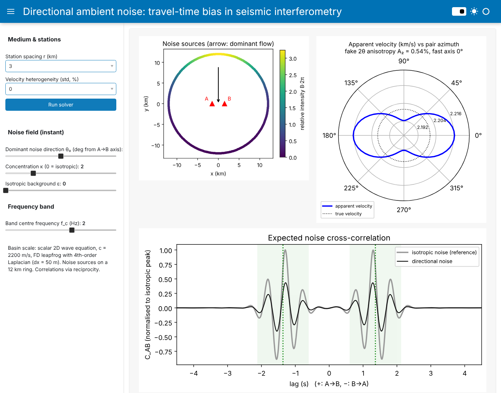

# Directional noise bias in DAS (fiber-optic) ambient-noise interferometry

GPGN 436/536 final project (Zach).

**Question.** Ambient-noise interferometry cross-correlates noise recorded at two points and treats the result as the Green's function between them. That is only exact when the noise arrives equally from all directions. Real noise is directional. In a sedimentary basin at 1–3 Hz it comes mostly from roads, towns and industry. Distributed acoustic sensing (DAS) on a fiber records exactly this kind of noise, with three complications:
- a strain channel has a $\cos^2\theta$ directional sensitivity;
- a straight cable cannot tell the direction a wave comes from apart from its velocity;
- the usual 2D-array (beamforming) correction is not available.

This project asks: *how biased are the velocities DAS interferometry measures, and can the cable layout help?* A station-pair version (with a 2D-array correction as a contrast case) is kept as the foundation.

**PDE and method.** The 2D scalar wave equation, $u_{tt} + \sigma u_t = c^2\nabla^2 u + f$, which stands in for P/Rayleigh-like waves, solved with the finite-difference leapfrog scheme from course module 06:
- 2nd order in time, with a 4th-order Laplacian
- a quadratic damping sponge as the absorbing boundary
- CFL limit $\sqrt{3/8}$

By reciprocity, one impulse simulation per receiver (station or cable node), recorded at every noise source, gives all source-receiver Green's functions. After that, any noise distribution and any frequency band are just a re-weighted sum. DAS channels are computed from the cable-node records with a gauge-length strain operator: axial strain $\partial^2 u/\partial s^2$, using the 4th-order derivative stencil from course module 02.



## Files

| file | contents |
|---|---|
| `simulation.py` | All numerics: grid/model, sponge, Ricker source, FD solver, analytic Green's function, noise distributions (von Mises ring, roads), reciprocity correlations, travel-time picking, stationary-phase predictions; `PairExperiment` (station pair), `ArrayExperiment` (2D array + beamforming), `FiberExperiment` (DAS cable, strain operator, slant stacks). No UI code, importable on its own. |
| `app.py` | Panel UI with two tabs, *Station pair* and *DAS fiber*. It only wires widgets to `simulation.py`. |
| `verification.ipynb` | Tests of `simulation.py` against analytic solutions: 2D Green's function, convergence in Δx (order ≈ 4) and Δt (order ≈ 2), CFL limit, sponge reflections, Green's function retrieval from an isotropic ring, directional bias vs exact Hankel sum and stationary-phase theory, the beamformer, and the DAS strain operator (cos²θ·sinc response, 4th-order convergence). |
| `das_fiber.ipynb` | **Main results.** DAS vs geophone bias for isotropic noise, traffic roads (parallel / perpendicular / oblique), gauge length, the straight-cable azimuth–velocity ambiguity, and mitigation with an L-shaped cable. |
| `experiments.ipynb` | Station-pair results: bias vs κ and θ₀, vs spacing r/λ, fake azimuthal anisotropy, isotropic background, (exploratory) scattering. |
| `array_correction.ipynb` | Contrast case: a 25-station 2D array beamforms the noise, inverts for B(θ), and corrects every pair, which a fiber cannot do. |

## Running it yourself

```bash
git clone https://github.com/zach-shallenberger/GPCOMP-ambient-directionality.git
cd GPCOMP-ambient-directionality
conda env create -f environment.yml     # isolated env named "ambient-noise"
conda activate ambient-noise
```

No conda? Use a virtual environment instead: `python -m venv .venv`, activate it (`source .venv/bin/activate`, or `.venv\Scripts\activate` on Windows), then `pip install -r requirements.txt`.

**Interactive app.** Run `panel serve app.py --show`. The page opens right away and starts the station-pair solver, with a progress bar in the sidebar (the terminal also prints progress). The default *fast* grid (Δx = 100 m) takes a few seconds; *standard* (Δx = 50 m, the grid the notebooks use) takes about 15 s. Drag the noise sliders and they update instantly. The *DAS fiber* tab runs one FD problem per cable node (about 120 on the fast grid, run in parallel on all CPU cores; about a minute on a 4-core laptop) the first time you press *Run DAS analysis*. Every result is saved to `.cache/`, so anything you have already run reloads instantly, even after restarting the app.

**Notebooks.** Run `jupyter notebook`, open a notebook and choose *Run All*. Run times on a 4-core laptop are roughly: `verification` 5 min, `experiments` 5 min, `das_fiber` 10 min (240 FD runs), `array_correction` 10 min.

**From your own script.** Any experiment can be run in a few lines:

```python
import numpy as np, simulation as S

m = S.Model(c=S.random_medium(S.Model(), rel_std=0.02, corr_len=0.1, seed=1))  # or S.Model() for homogeneous
exp = S.PairExperiment(m, r=3.0)                 # stations 3 km apart; 2 FD runs
ref = exp.correlate(exp.weights(), fc=2.0)       # isotropic-noise reference
w = exp.weights(theta0=np.pi / 2, kappa=3.0, eps=0.0)   # broadside, concentrated noise
print(exp.measure(exp.correlate(w, fc=2.0), ref, fc=2.0))   # bias in s, dv/v in %
```

Change `rel_std`, `corr_len` (km) or `seed` to try other random media. Running several seeds and averaging them is the natural next step for the scattering study.

Units are km, s, and km/s throughout. Defaults (in `simulation.py`): c = 2.2 km/s, Ricker source at 2 Hz (λ = 1.1 km), Δx = 50 m, Δt ≈ 11 ms, a 701 × 701 grid, and about 500 ring sources.

## Main findings

**DAS fiber** (`das_fiber.ipynb`, c = 2.2 km/s, 2 Hz, λ = 1.1 km):
- **Built-in instrument bias.** Even with perfectly isotropic noise, DAS interferometry looks slow, because the $\cos^4\theta$ strain sensitivity adds curvature to the effective noise distribution. The FD result is 7.7% at 1 km offset, 1.6% at 2 km and 0.7% at 3 km. The stationary-phase prediction $2/(\omega t)^2$ gives 5.8%, 1.45% and 0.64%; it is approximate below about one wavelength. Since the bias is deterministic, it can be subtracted.
- **Traffic roads.** An endfire road is benign for DAS; geophones there show a +5% near-field error that the DAS directivity suppresses. A broadside road gives offset-dependent errors of a few percent. An oblique road gives the largest error that cannot be corrected (about −3% at 2 km).
- **A straight cable is blind to azimuth.** The slant-stack velocity is $c/|\cos\theta|$, always too fast.
- **L-shaped cable.** Use the leg whose correlation is most one-sided (endfire illumination), then subtract the instrument bias. This avoids a +22% error on the wrong leg and leaves 0.1–0.2% error in three of four cases. The oblique road is the exception (−1.2%).

**Station pairs and arrays** (`experiments.ipynb`, `array_correction.ipynb`):
- The bias depends on the noise curvature $B''/B$ at the endfire directions (Weaver et al. 2009) and scales as $(r/\lambda)^{-2}$. Broadside noise makes the basin look fast (+3% at κ = 4, 2.7λ spacing). A single noise direction creates a fake $2\theta$ anisotropy of about 0.5% (κ = 2) to 1.8% (κ = 4).
- A 2D array can beamform the noise, invert for $B(\theta)$ and correct the bias. With 8 h of noise this cuts the fake anisotropy from 0.9% to about 0.1%, but with under about 1 h of noise the correction makes things worse.

## AI-use statement
This project was developed with Claude (Anthropic) used as an AI coding agent through Claude Code. Claude helped draft the project plan and the solver, interferometry, and UI code and the notebooks, and ran the verification tests. I checked the physics and results and am responsible for them. *(Edit this statement to describe how you actually reviewed and changed the code.)*

## References
- Course notebooks GPGN 436/536 (Dr. Ge Jin, Dr. Jeff Shragge), especially 06_Hyperbolic_PDEs (FD wave solver) and 09_Regression (least-squares fit).
- Snieder, R. (2004). Extracting the Green's function from the correlation of coda waves: a derivation based on stationary phase. *Phys. Rev. E* 69, 046610.
- Wapenaar, K. (2004). Retrieving the elastodynamic Green's function of an arbitrary inhomogeneous medium by cross correlation. *PRL* 93, 254301.
- Weaver, R., Froment, B., & Campillo, M. (2009). On the correlation of non-isotropically distributed ballistic scalar diffuse waves. *JASA* 126, 1817–1826.
- Lindsey, N. J., & Martin, E. R. (2021). Fiber-optic seismology. *Annu. Rev. Earth Planet. Sci.* 49, 309–336.
- Froment, B., et al. (2010). Estimation of the effect of nonisotropically distributed energy on the apparent arrival time in correlations. *Geophysics* 75, SA85–SA93.
- Stehly, L., Campillo, M., & Shapiro, N. M. (2006). A study of the seismic noise from its long-range correlation properties. *JGR* 111, B10306.
- Bensen, G. D., et al. (2007). Processing seismic ambient noise data to obtain reliable broad-band surface wave dispersion measurements. *GJI* 169, 1239–1260.
- Libraries: NumPy, SciPy (`hankel1`, `i0e`, `gaussian_filter`), Matplotlib, Panel.
