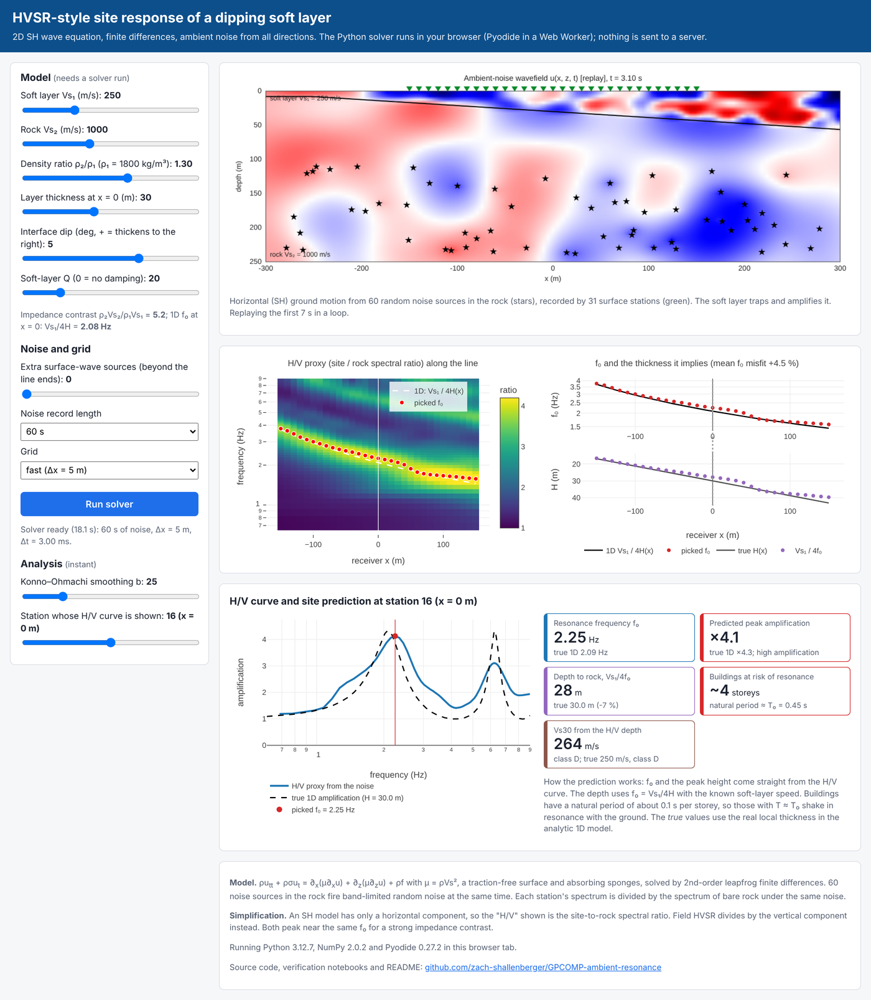

# HVSR-style site response of a dipping soft layer from ambient noise

**Live app: [https://zach-shallenberger.github.io/GPCOMP-ambient-resonance/](https://zach-shallenberger.github.io/GPCOMP-ambient-resonance/)**. It runs in the browser, with no installation and no server: the Python solver runs on your computer through Pyodide in a Web Worker.

**Geophysical problem.** The horizontal-to-vertical spectral ratio (HVSR) of ambient noise is one of the most widely used tools for mapping soft sediments: its peak frequency f₀ gives the depth to bedrock through the 1D rule f₀ = Vs₁/4H, and its peak tells how strongly the site amplifies shaking, which matters for seismic hazard and for buildings whose natural period matches the site. The 1D rule assumes flat layers. This project asks how wrong it becomes when the soft layer sits on a **dipping** bedrock interface, and how that depends on the impedance contrast.

**Model.** A 2D depth slice (x–z) with a soft layer over rock. The user sets the interface **dip** and the **property contrast** (Vs and density, so the impedance contrast). 60 random noise sources in the rock fire band-limited noise at the same time, so waves reach the surface from all directions.

**Governing equation.** The SH (antiplane) wave equation for the out-of-plane displacement u(x, z, t):

$$\rho\,u_{tt} + \rho\,\sigma\,u_t = \partial_x(\mu\,\partial_x u) + \partial_z(\mu\,\partial_z u) + \rho f,\qquad \mu = \rho V_s^2$$

where σ(x, z) is the sponge damping plus a viscous damping in the soft layer (Q = 20 at f₀) and f is the sum of the noise sources.

**Numerical approach** (all in `simulate_noise` in `hvsr.py`, following the course's hyperbolic-PDE notebook):
- Explicit 2nd-order leapfrog (central differences) in time, with the damping term treated semi-implicitly; time step from the CFL condition, Δt = 0.6 Δx / max(Vs).
- Conservative 2nd-order finite-difference operator in space, with the harmonic mean of μ on cell faces so that the layer interface (and its dip) is represented between grid nodes.
- **Initial conditions:** the medium starts at rest, u = u_t = 0. All motion comes from the noise sources.
- **Boundary conditions:** traction-free surface μ ∂u/∂z = 0 at z = 0 (mirror/ghost node); absorbing damping sponges (300 m on the sides, 400 m at the bottom) on the other three sides. The verification uses a periodic x boundary to make a laterally infinite model.
- Post-processing: 31 surface receivers record u. Each receiver's spectrum (Welch, 10 s windows, Konno–Ohmachi smoothing) is divided by the spectrum of bare rock under the same noise, and f₀ is picked from that ratio and compared with the 1D rule f₀ = Vs₁/4H(x).

**Simplification.** A scalar/SH model has only a horizontal (out-of-plane) component, so it cannot form a true H/V ratio. We use the site-to-reference spectral ratio instead. For a strong contrast it peaks near the same f₀ as field HVSR, but the amplitudes are not those of H/V.



| file | contents |
|---|---|
| `hvsr.py` | All numerics: `Model` (two layers, dip, contrast, damping, 1D f₀ and the analytic transfer function), `noise_sources`, `simulate_noise` (the solver), Welch spectra, Konno–Ohmachi smoothing, `spectral_ratio`, `pick_f0`, `run_profile`. No UI code. |
| `web/` | The browser app published on GitHub Pages. `index.html` and `style.css` (layout), `app.js` (controls and Plotly plots, no physics), `worker.js` (the Web Worker that loads Pyodide and NumPy and runs the Python code off the main thread, so the page stays responsive), `bridge.py` (Python glue that calls `hvsr.py` and packs results for JavaScript), `versions.json` (pinned browser versions). The page has sliders for Vs₁, Vs₂, the density ratio, thickness, dip, Q, surface-wave sources, record length and grid. It shows the wavefield live while the solver runs and then replays it, the ratio along the line, and f₀ and the implied thickness against the truth. A station slider shows that station's H/V curve next to the true 1D amplification, with tiles of site predictions from that curve: f₀, peak amplification, depth to rock, the building heights at risk of resonance (about 0.1 s of natural period per storey) and Vs30, each against the true value. A run takes about 20 s in the browser on the fast grid. |
| `.github/workflows/pages.yml` | GitHub Actions workflow. On every push to `main` it smoke-tests `hvsr.py`, copies `web/` and `hvsr.py` into one folder and deploys it to GitHub Pages. |
| `hvsr_app.py` | Optional local version of the same interface in Panel (`panel serve hvsr_app.py --show`). It imports the same `hvsr.py`. |
| `hvsr_verification.ipynb` | FD vs the analytic 1D SH transfer function (f₀ 2.087 vs 2.084 Hz, peak 5.17 vs 5.11, 1.5% L2 error). Convergence order 1.8 in Δx and 1.7 in Δt. Sponge length: 150 m gives 32% error at 1–4 Hz, 400 m gives 5%, 1000 m gives 1%. The sub-cell interface keeps f₀ within 1.6% between grid nodes. Flat layer under noise from all directions: f₀ within 3.6%. |
| `hvsr_analytical_verification.ipynb` | The solver against closed-form results for a layer over a half-space: the full 1D SH transfer function, f₀ = Vs₁/4H for many thicknesses and speeds, higher modes at (2n+1)f₀ with equal heights, peak amplitude = impedance contrast C undamped and 1/(1/C + π/4Q) damped (whether the contrast comes from density or velocity), 2nd-order grid convergence of all of these, and the recovery of the local 1D rule f₀(x) = Vs₁/4H(x) as the dip goes to 0. About 5 min to run. |
| `hvsr_dipping_layer.ipynb` | **Main results** (below). About 10 min to run. |

## Main findings
- **Flat layer.** With noise from all directions, f₀ = Vs₁/4H within 4% at every receiver. The peak is about 12% below the 1D vertical-incidence value.
- **Dip.** f₀ varies more smoothly along the line than Vs₁/4H(x), so converting with the 1D rule underestimates the depth. The mean error is −4% at 5°, −11% at 10° and −15% at 15°, and up to −25 to −35% under the thick side.
- **Contrast.** A stronger contrast makes the 2D error larger, not smaller. At 10° dip the f₀ error is about 5% for a contrast of 2.6 but 20–35% for a contrast of 10, because a strong contrast traps the waves and lets them spread along the layer. The peak is taller and easier to pick, but harder to interpret with 1D theory.
- **Surface-wave noise** from nearby lateral sources makes the ratio station-dependent.

## Running it yourself

```bash
git clone https://github.com/zach-shallenberger/GPCOMP-ambient-resonance.git
cd GPCOMP-ambient-resonance
conda env create -f environment.yml     # isolated env named "ambient-noise"
conda activate ambient-noise
```

Tested from a fresh clone with Python 3.13 and `pip install -r requirements.txt`. No data files are needed: every model and noise record is generated by the code.

No conda? Use a virtual environment instead: `python -m venv .venv`, activate it (`source .venv/bin/activate`, or `.venv\Scripts\activate` on Windows), then `pip install -r requirements.txt`.

**Web app.** Open [https://zach-shallenberger.github.io/GPCOMP-ambient-resonance/](https://zach-shallenberger.github.io/GPCOMP-ambient-resonance/) in a recent Chrome, Firefox, Edge or Safari. The first load downloads Python and NumPy (about 15 MB, then cached by the browser) and runs the default model with its bare-rock reference (about 20 s). The wavefield is drawn live while it runs, then loops. Change the model sliders and press *Run solver*. The station slider and the smoothing control update instantly, and models you already ran come back from memory.

To preview the site from a local checkout, serve the repository root and open the `web/` folder (a Web Worker cannot load from a `file://` page):

```bash
python -m http.server 8000      # then open http://localhost:8000/web/
```

**Optional local Panel app.** `panel serve hvsr_app.py --show` runs the same solver natively (about 12 s per model) and caches every model in `.cache/`.

**Notebooks.** Run `jupyter notebook`, open a notebook and choose *Run All*: `hvsr_verification` takes about 1.5 min, `hvsr_analytical_verification` about 5 min, `hvsr_dipping_layer` about 10 min.

**Working example (from your own script).** This runs the default dipping model without the UI:

```python
import hvsr as H

m = H.Model(vs1=250, vs2=1000, h0=30, dip=10)     # soft layer over rock, 10 deg dip
r = H.run_profile(m, H.default_grid(5.0), T=60)   # site run + bare-rock reference (~15 s)
for x, f0 in zip(r["rec_x"], r["f0"]):
    print(f"x = {x:5.0f} m   f0 = {f0:.2f} Hz   1D Vs1/4H = {m.f0_1d(x):.2f} Hz")
```

Expected result (the noise is seeded, so the numbers repeat; 31 lines, every 5th shown):

```
x =  -150 m   f0 = 7.38 Hz   1D Vs1/4H = 7.81 Hz
x =  -100 m   f0 = 5.66 Hz   1D Vs1/4H = 5.05 Hz
x =   -50 m   f0 = 3.38 Hz   1D Vs1/4H = 2.95 Hz
x =     0 m   f0 = 2.48 Hz   1D Vs1/4H = 2.08 Hz
x =    50 m   f0 = 1.68 Hz   1D Vs1/4H = 1.61 Hz
x =   100 m   f0 = 1.57 Hz   1D Vs1/4H = 1.31 Hz
x =   150 m   f0 = 1.48 Hz   1D Vs1/4H = 1.11 Hz
```

f₀ falls from about 7 Hz to 1.5 Hz as the layer thickens to the right, but more smoothly than the 1D rule: under the thick side f₀ is up to about 35% too high, so H = Vs₁/4f₀ would put bedrock too shallow. That is the main finding below.

**Expected app result.** With the default sliders (the web app and the Panel app give the same numbers) (Vs₁ 250 m/s, Vs₂ 1000 m/s, 30 m at x = 0, 5° dip, Q 20, 60 s of noise) the app reports an impedance contrast of 5.2 and a 1D f₀ of 2.08 Hz at x = 0. The ratio panel shows a bright band falling from about 4 Hz on the left to about 1.5 Hz on the right, with the picked f₀ (red dots) close to, and slightly above, the white dashed 1D line; the implied thickness follows the true H(x) to within a few metres (screenshot above). At station 16 (x = 0) the tiles show f₀ = 2.25 Hz against a true 1D 2.09 Hz, a peak amplification of ×4.1 against ×4.3, and a depth to rock of 28 m against the true 30 m.

Units are SI (m, s, m/s, kg/m³).

## Browser app: dependencies and deployment

| component | version | loaded from |
|---|---|---|
| Pyodide (Python in WebAssembly) | 0.27.2 (Python 3.12.7) | `cdn.jsdelivr.net/pyodide/v0.27.2/full/` in `web/worker.js` |
| NumPy (Pyodide package) | 2.0.2 | `pyodide.loadPackage("numpy")` |
| Plotly.js | 2.35.2 (`plotly.js-dist-min`) | `cdn.jsdelivr.net` in `web/index.html` |

The same list is in `web/versions.json`. The simulation itself needs only NumPy, so the browser and the notebooks run identical code. `requirements.txt` and `environment.yml` are for running `hvsr.py`, the notebooks and the optional Panel app locally.

**How the deployment works.** `.github/workflows/pages.yml` runs on every push to `main` (or by hand from the *Actions* tab). It checks that `hvsr.py` imports and runs, assembles `web/*` and `hvsr.py` into one folder, and publishes it with `actions/upload-pages-artifact` and `actions/deploy-pages`. There is no server: GitHub Pages only hosts static files. To deploy a fork, set *Settings → Pages → Build and deployment → Source* to **GitHub Actions** once, then push to `main`.

## AI-use statement
This project was developed with Claude (Anthropic) used as an AI coding agent through Claude Code. Claude helped draft the project plan and the solver, spectral-ratio and picking code, the browser interface, Web Worker and GitHub Pages workflow, and the notebooks, and ran the verification tests. I checked the physics and results and am responsible for them. *(Edit this statement to describe how you actually reviewed and changed the code.)*

## References
- Nakamura, Y. (1989). A method for dynamic characteristics estimation of subsurface using microtremor on the ground surface. *QR of RTRI* 30(1), 25–33.
- Konno, K., & Ohmachi, T. (1998). Ground-motion characteristics estimated from spectral ratio between horizontal and vertical components of microtremor. *BSSA* 88(1), 228–241.
- Bard, P.-Y., & Bouchon, M. (1985). The two-dimensional resonance of sediment-filled valleys. *BSSA* 75(2), 519–541.
- SESAME (2004). Guidelines for the implementation of the H/V spectral ratio technique on ambient vibrations. European Commission project WP12.
- Kramer, S. L. (1996). *Geotechnical Earthquake Engineering*. Prentice Hall (1D SH transfer function of a layer over a half-space).
- Virieux, J. (1984). SH-wave propagation in heterogeneous media: velocity-stress finite-difference method. *Geophysics* 49(11), 1933–1942.
- Course notebooks GPGN 436/536 (Dr. Ge Jin, Dr. Jeff Shragge), especially 06_Hyperbolic_PDEs (FD wave solver).
- Libraries: NumPy, Matplotlib, Pillow, Panel; in the browser Pyodide (pyodide.org) and Plotly.js.
