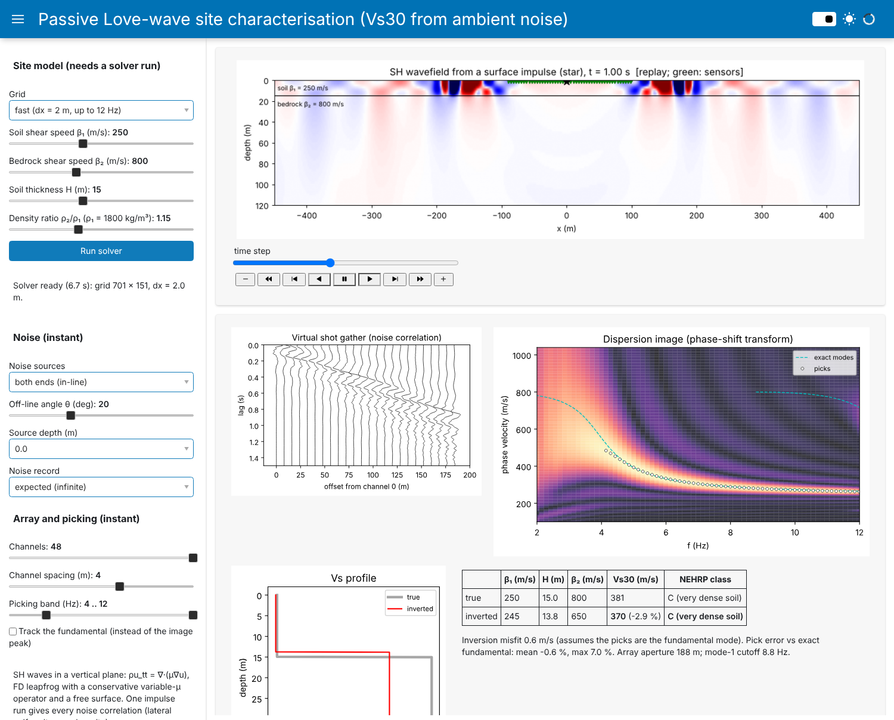

# Passive Love-wave site characterisation from ambient noise

GPGN 436/536 final project (Zach).

**Question.** Engineers classify sites for earthquake shaking by **Vs30**, the average shear-wave speed of the top 30 m, often measured *passively* from ambient noise on a line of surface sensors (passive MASW, ReMi). *How well does ambient noise recover a site's shear-wave structure and Vs30, and when does it fail?* The project simulates the whole chain against an exact answer: FD wave simulation → noise cross-correlations → virtual shot gather → phase-shift dispersion image → picked dispersion curve → inversion → Vs30 and NEHRP site class. It then measures the known failure modes: short arrays, directional and off-line noise, and higher-mode mispicks.

**PDE and method.** SH motion in a vertical $x$–$z$ plane obeys the scalar wave equation *exactly*,
$\rho(z)\,u_{tt} = \partial_x(\mu u_x) + \partial_z(\mu u_z) + f$, with $\mu = \rho\beta^2$ and a stress-free surface $\mu u_z = 0$ at $z = 0$. Love waves are its trapped, dispersive surface waves in a slow soil layer. It is solved by the leapfrog scheme from course module 06, extended to variable coefficients:
- a conservative 2nd-order operator with $\mu$ averaged harmonically at half-points (traction continuity at the soil–rock interface)
- an even-mirror ghost row for the free surface
- damping sponges on the sides and bottom
- CFL limit $1/\sqrt2$

Because the site is laterally uniform, **one** impulse run gives the Green's function for every source–receiver pair (translation + reciprocity), so every noise scenario is an instant re-weighting. The exact answer is the Love-wave dispersion relation for a layer over a half-space, solved with `scipy.optimize.brentq`. The inversion for $(\beta_1, H, \beta_2)$ uses damped Gauss–Newton (09_Regression).



## Files

| file | contents |
|---|---|
| `love_waves.py` | All numerics for the site project: `Site` model, Love dispersion root finder and group velocity, Vs30 and NEHRP class, `Grid` + `simulate_sh` (variable-μ SH solver), `phase_shift` dispersion image, `pick_ridge` (peak or ridge-tracking), `invert_site`, and `LoveLine` (one FD run → noise gathers, active gathers, finite-record noise). No UI code. |
| `site_app.py` | Panel UI for the site project. It only wires widgets to `love_waves.py`. |
| `site_verification.ipynb` | Tests against analytic solutions: whole-space Green's function (order 2.0 in Δx and Δt), free surface vs image source (order 2.0), interface reflection coefficient (conservative operator → −0.577 exact; the naive $\beta^2\nabla^2u$ operator gives +0.52), dispersion-relation residual and cutoffs, full chain FD → picks vs exact roots (−0.25% at Δx = 1 m, converging as Δx²), side-sponge reflections (0.6%). |
| `site_characterization.ipynb` | **Main results** (see below). |
| `simulation.py`, `app.py`, other notebooks | The earlier DAS directional-noise study (below). `love_waves.py` reuses its Ricker wavelet and analytic 2D Green's function. |

## Main findings (site project)

Default site: 15 m of soil at 250 m/s over bedrock at 800 m/s, so Vs30 = 381 m/s, class C. The array is 48 sensors at 4 m, with noise in the 3–20 Hz band.
- **The passive chain works.** The noise-derived dispersion image matches the active-shot one, and fundamental picks match the exact curve to within 0.7% at 5–12 Hz. A finite noise record adds scatter: 3.7% RMS for 1 window, 0.4% after about 100 windows.
- **Aperture.** Picks are within 1% only for $\lambda \lesssim L/3$. The errors are 10–20% at $\lambda \approx L$. Short lines lose the low frequencies, which are what sense the bedrock. Even the 188 m line inverts β₂ as about 650 m/s instead of 800, although Vs30 is still within 3%.
- **Noise direction.** One-sided noise along the line is harmless once the causal and acausal branches are folded. **Off-line noise** biases phase velocity fast by exactly $1/\cos\theta$, with a low misfit, so the error is invisible. At 40° Vs30 comes out 12% high.
- **Mode mispicks.** At this strong-contrast site, surface sources put more energy into mode 1 than into the fundamental above 12.6 Hz. A peak picker jumps modes, and the inversion then misclassifies the site as **D**. Ridge tracking gives Vs30 within 3% (class C), and the inversion misfit (88 vs 1.5 m/s) flags the bad case.

## Running it yourself

```bash
git clone https://github.com/zach-shallenberger/GPCOMP-ambient-directionality.git
cd GPCOMP-ambient-directionality
conda env create -f environment.yml     # isolated env named "ambient-noise"
conda activate ambient-noise
```

No conda? Use a virtual environment instead: `python -m venv .venv`, activate it (`source .venv/bin/activate`, or `.venv\Scripts\activate` on Windows), then `pip install -r requirements.txt`.

**Interactive apps.** Run `panel serve site_app.py --show` for the site-characterisation project. On first load it runs one FD solve (about 7 s on the default fast grid, 30–60 s on the standard 1 m grid). The wavefield is drawn live while it runs, then turns into a looping animation (an animated GIF, so it plays smoothly in any browser) of a source 250 m from the array. After that, every noise, array and picking control updates instantly, and each site model is cached. The DAS study app is `panel serve app.py --show`. The page opens right away and starts the station-pair solver, with a progress bar in the sidebar (the terminal also prints progress). The default *fast* grid (Δx = 100 m) takes a few seconds; *standard* (Δx = 50 m, the grid the notebooks use) takes about 15 s. Drag the noise sliders and they update instantly. The *DAS fiber* tab runs one FD problem per cable node (about 120 on the fast grid, run in parallel on all CPU cores; about a minute on a 4-core laptop) the first time you press *Run DAS analysis*. Every result is saved to `.cache/`, so anything you have already run reloads instantly, even after restarting the app.

**Notebooks.** Run `jupyter notebook`, open a notebook and choose *Run All*. Run times on a 4-core laptop are roughly: `site_verification` 7 min (one 0.5 m grid run dominates), `site_characterization` 3 min, `verification` 5 min, `experiments` 5 min, `das_fiber` 10 min (240 FD runs), `array_correction` 10 min.

**From your own script (site project).**

```python
import numpy as np, love_waves as L

site = L.Site(b1=250, b2=800, H=15)               # soil over bedrock
ll = L.LoveLine(site)                             # one FD run (~30-60 s at dx = 1 m)
rx = L.channels(48, 4.0)                          # 48 sensors, 4 m apart
U = ll.noise_gather(rx, L.line_sources("offline", theta_deg=20, rec_x=rx))
c = np.linspace(150, 900, 751)
f, cp = L.pick_ridge(L.phase_shift(U, rx - rx[0], ll.f, c), c, ll.f, 4, 20, track=True)
p, misfit = L.invert_site(f, cp)                  # (beta1, H, beta2)
print(p, L.vs30(*p), L.site_class(L.vs30(*p)))
```

Units are SI (m, s, m/s) in `love_waves.py`.

**From your own script (DAS study).** Any experiment can be run in a few lines:

```python
import numpy as np, simulation as S

m = S.Model(c=S.random_medium(S.Model(), rel_std=0.02, corr_len=0.1, seed=1))  # or S.Model() for homogeneous
exp = S.PairExperiment(m, r=3.0)                 # stations 3 km apart; 2 FD runs
ref = exp.correlate(exp.weights(), fc=2.0)       # isotropic-noise reference
w = exp.weights(theta0=np.pi / 2, kappa=3.0, eps=0.0)   # broadside, concentrated noise
print(exp.measure(exp.correlate(w, fc=2.0), ref, fc=2.0))   # bias in s, dv/v in %
```

Change `rel_std`, `corr_len` (km) or `seed` to try other random media. Running several seeds and averaging them is the natural next step for the scattering study.

Units are km, s, and km/s throughout. Defaults (in `simulation.py`): c = 2.2 km/s, Ricker source at 2 Hz (λ = 1.1 km), Δx = 50 m, Δt ≈ 11 ms, a 701 × 701 grid, and about 500 ring sources.

---

# Earlier study: directional noise bias in DAS (fiber-optic) ambient-noise interferometry

**Question.** Ambient-noise interferometry cross-correlates noise recorded at two points and treats the result as the Green's function between them. That is only exact when the noise arrives equally from all directions. Real noise is directional. In a sedimentary basin at 1–3 Hz it comes mostly from roads, towns and industry. Distributed acoustic sensing (DAS) on a fiber records exactly this kind of noise, with three complications:
- a strain channel has a $\cos^2\theta$ directional sensitivity;
- a straight cable cannot tell the direction a wave comes from apart from its velocity;
- the usual 2D-array (beamforming) correction is not available.

This project asks: *how biased are the velocities DAS interferometry measures, and can the cable layout help?* A station-pair version (with a 2D-array correction as a contrast case) is kept as the foundation.

**PDE and method.** The 2D scalar wave equation, $u_{tt} + \sigma u_t = c^2\nabla^2 u + f$, which stands in for P/Rayleigh-like waves, solved with the finite-difference leapfrog scheme from course module 06:
- 2nd order in time, with a 4th-order Laplacian
- a quadratic damping sponge as the absorbing boundary
- CFL limit $\sqrt{3/8}$

By reciprocity, one impulse simulation per receiver (station or cable node), recorded at every noise source, gives all source-receiver Green's functions. After that, any noise distribution and any frequency band are just a re-weighted sum. DAS channels are computed from the cable-node records with a gauge-length strain operator: axial strain $\partial^2 u/\partial s^2$, using the 4th-order derivative stencil from course module 02.


### Files (DAS study)

| file | contents |
|---|---|
| `simulation.py` | All numerics: grid/model, sponge, Ricker source, FD solver, analytic Green's function, noise distributions (von Mises ring, roads), reciprocity correlations, travel-time picking, stationary-phase predictions; `PairExperiment` (station pair), `ArrayExperiment` (2D array + beamforming), `FiberExperiment` (DAS cable, strain operator, slant stacks). No UI code, importable on its own. |
| `app.py` | Panel UI with two tabs, *Station pair* and *DAS fiber*. It only wires widgets to `simulation.py`. |
| `verification.ipynb` | Tests of `simulation.py` against analytic solutions: 2D Green's function, convergence in Δx (order ≈ 4) and Δt (order ≈ 2), CFL limit, sponge reflections, Green's function retrieval from an isotropic ring, directional bias vs exact Hankel sum and stationary-phase theory, the beamformer, and the DAS strain operator (cos²θ·sinc response, 4th-order convergence). |
| `das_fiber.ipynb` | **Main results.** DAS vs geophone bias for isotropic noise, traffic roads (parallel / perpendicular / oblique), gauge length, the straight-cable azimuth–velocity ambiguity, and mitigation with an L-shaped cable. |
| `experiments.ipynb` | Station-pair results: bias vs κ and θ₀, vs spacing r/λ, fake azimuthal anisotropy, isotropic background, (exploratory) scattering. |
| `array_correction.ipynb` | Contrast case: a 25-station 2D array beamforms the noise, inverts for B(θ), and corrects every pair, which a fiber cannot do. |

### Main findings (DAS study)

**DAS fiber** (`das_fiber.ipynb`, c = 2.2 km/s, 2 Hz, λ = 1.1 km):
- **Built-in instrument bias.** Even with perfectly isotropic noise, DAS interferometry looks slow, because the $\cos^4\theta$ strain sensitivity adds curvature to the effective noise distribution. The FD result is 7.7% at 1 km offset, 1.6% at 2 km and 0.7% at 3 km. The stationary-phase prediction $2/(\omega t)^2$ gives 5.8%, 1.45% and 0.64%; it is approximate below about one wavelength. Since the bias is deterministic, it can be subtracted.
- **Traffic roads.** An endfire road is benign for DAS; geophones there show a +5% near-field error that the DAS directivity suppresses. A broadside road gives offset-dependent errors of a few percent. An oblique road gives the largest error that cannot be corrected (about −3% at 2 km).
- **A straight cable is blind to azimuth.** The slant-stack velocity is $c/|\cos\theta|$, always too fast.
- **L-shaped cable.** Use the leg whose correlation is most one-sided (endfire illumination), then subtract the instrument bias. This avoids a +22% error on the wrong leg and leaves 0.1–0.2% error in three of four cases. The oblique road is the exception (−1.2%).

**Station pairs and arrays** (`experiments.ipynb`, `array_correction.ipynb`):
- The bias depends on the noise curvature $B''/B$ at the endfire directions (Weaver et al. 2009) and scales as $(r/\lambda)^{-2}$. Broadside noise makes the basin look fast (+3% at κ = 4, 2.7λ spacing). A single noise direction creates a fake $2\theta$ anisotropy of about 0.5% (κ = 2) to 1.8% (κ = 4).
- A 2D array can beamform the noise, invert for $B(\theta)$ and correct the bias. With 8 h of noise this cuts the fake anisotropy from 0.9% to about 0.1%, but with under about 1 h of noise the correction makes things worse.

## AI-use statement
This project was developed with Claude (Anthropic) used as an AI coding agent through Claude Code. Claude helped draft the project plan and the solvers, interferometry, dispersion and inversion code, the UI code and the notebooks, and ran the verification tests. I checked the physics and results and am responsible for them. *(Edit this statement to describe how you actually reviewed and changed the code.)*

## References
- Aki, K., & Richards, P. G. (2002). *Quantitative Seismology*, 2nd ed. (Love waves in a layer over a half-space).
- Park, C. B., Miller, R. D., & Xia, J. (1999). Multichannel analysis of surface waves. *Geophysics* 64(3), 800–808.
- Park, C. B., Xia, J., & Miller, R. D. (1998). Imaging dispersion curves of surface waves on multi-channel record. *SEG Expanded Abstracts*.
- Louie, J. N. (2001). Faster, better: shear-wave velocity to 100 meters depth from refraction microtremor arrays. *BSSA* 91(2), 347–364.
- Virieux, J. (1984). SH-wave propagation in heterogeneous media: velocity-stress finite-difference method. *Geophysics* 49(11), 1933–1942.
- Course notebooks GPGN 436/536 (Dr. Ge Jin, Dr. Jeff Shragge), especially 06_Hyperbolic_PDEs (FD wave solver) and 09_Regression (least-squares fit).
- Snieder, R. (2004). Extracting the Green's function from the correlation of coda waves: a derivation based on stationary phase. *Phys. Rev. E* 69, 046610.
- Wapenaar, K. (2004). Retrieving the elastodynamic Green's function of an arbitrary inhomogeneous medium by cross correlation. *PRL* 93, 254301.
- Weaver, R., Froment, B., & Campillo, M. (2009). On the correlation of non-isotropically distributed ballistic scalar diffuse waves. *JASA* 126, 1817–1826.
- Lindsey, N. J., & Martin, E. R. (2021). Fiber-optic seismology. *Annu. Rev. Earth Planet. Sci.* 49, 309–336.
- Froment, B., et al. (2010). Estimation of the effect of nonisotropically distributed energy on the apparent arrival time in correlations. *Geophysics* 75, SA85–SA93.
- Stehly, L., Campillo, M., & Shapiro, N. M. (2006). A study of the seismic noise from its long-range correlation properties. *JGR* 111, B10306.
- Bensen, G. D., et al. (2007). Processing seismic ambient noise data to obtain reliable broad-band surface wave dispersion measurements. *GJI* 169, 1239–1260.
- Libraries: NumPy, SciPy (`hankel1`, `i0e`, `gaussian_filter`, `brentq`, `CubicSpline`), Matplotlib, Panel.
